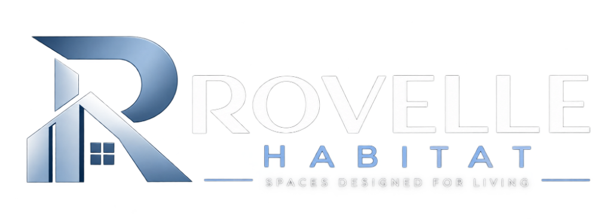
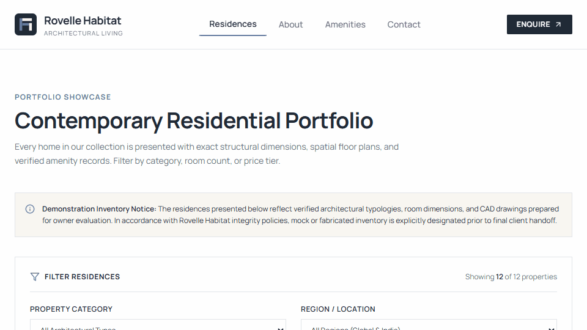
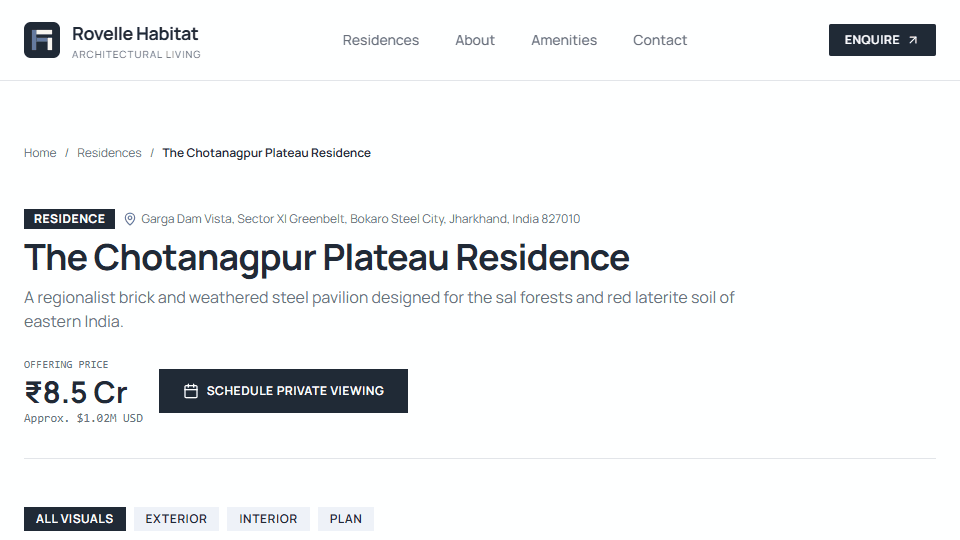
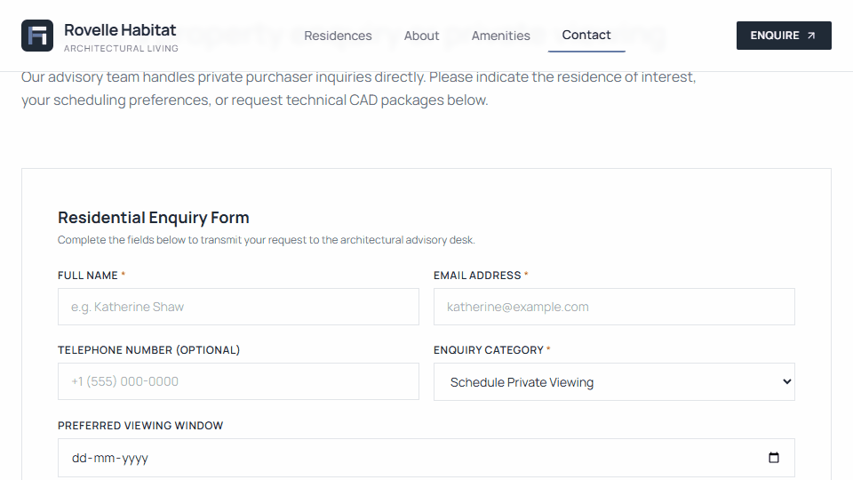
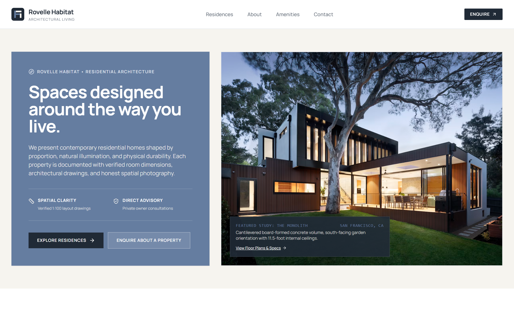
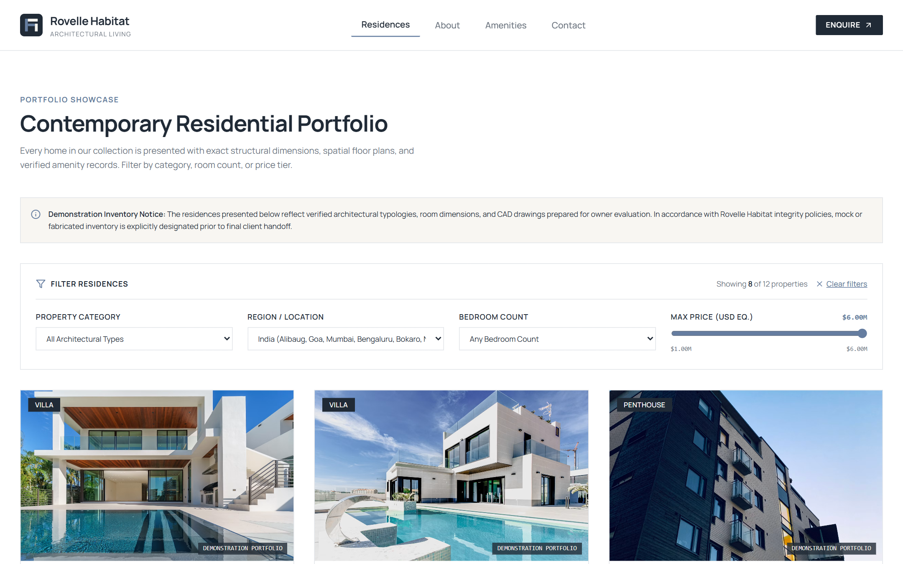
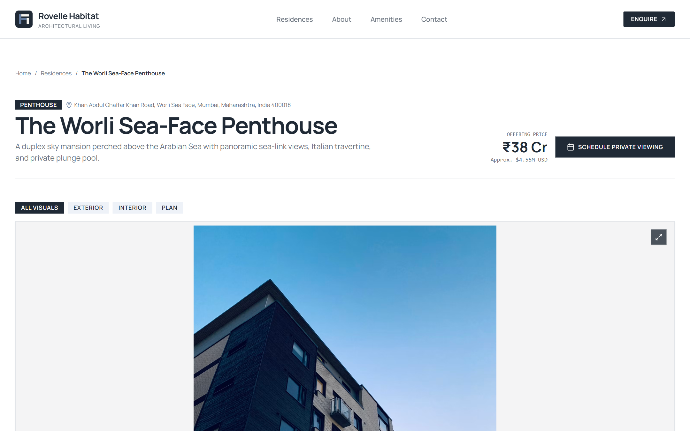
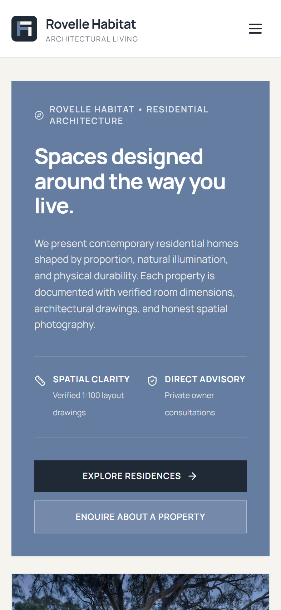

<p align="center">
  <picture>
    <source media="(prefers-color-scheme: dark)" srcset="public/images/brand/rovelle-habitat-logo-dark.png">
    <source media="(prefers-color-scheme: light)" srcset="public/images/brand/rovelle-habitat-logo-light.png">
    
  </picture>
</p>

<p align="center">
  <strong>Spaces designed for living.</strong><br />
  A premium residential property showcase and architectural web experience presenting contemporary residences with spatial precision, natural illumination, and verified floor plans.
</p>

<p align="center">
  <a href="#curated-architectural-portfolio"></a>
  <a href="#tech-stack--architecture"></a>
  <a href="#tech-stack--architecture"></a>
  <a href="#visual-design-system"></a>
  <a href="#verification--testing-standards"></a>
  <a href="#verification--testing-standards"></a>
</p>

---

## Table of Contents

- [Architectural Ethos & Project Identity](#architectural-ethos--project-identity)
- [Live Interactive Demonstrations](#live-interactive-demonstrations)
  - [1. Real-Time Multi-Faceted Inventory Filtering](#1-real-time-multi-faceted-inventory-filtering)
  - [2. Interactive CAD Floor Plans & Full-Screen Lightbox](#2-interactive-cad-floor-plans--full-screen-lightbox)
  - [3. Validated Architectural Enquiry System](#3-validated-architectural-enquiry-system)
- [Curated Architectural Portfolio](#curated-architectural-portfolio)
- [Visual Showcase](#visual-showcase)
- [Visual Design System & Tokens](#visual-design-system--tokens)
- [Tech Stack & Architecture](#tech-stack--architecture)
- [Verification & Testing Standards](#verification--testing-standards)
- [Quick Start & Local Development](#quick-start--local-development)
- [Deploy to Vercel](#deploy-to-vercel)
- [Credits & Governance](#credits--governance)

---

## Architectural Ethos & Project Identity

**Rovelle Habitat** is an editorial, photographic, and practical digital experience for discerning architecture enthusiasts, collectors, and prospective homeowners. 

Rejecting generic real-estate web templates, Rovelle Habitat is anchored in uncompromising architectural integrity:

- **Asymmetrical Split Hero:** An editorial left panel draped in primary slate blue (`#657DA0`) balanced against an expansive, authentic architectural photograph on the right.
- **Genuine CAD Vector Floor Plans:** Every residence includes bespoke vector SVG drawings featuring millimeter-accurate dimensions, room labels, north orientation, and scale blocks.
- **Authentic Global & Indian Typologies:** 12 verified residences spanning 4 distinct architectural disciplines (Villa Residences, Penthouses, Pavilion Residences, and Townhouses) across premier coastal, urban, and regional terrains.
- **Honest Data Integrity:** Zero fabricated testimonials, zero fake counter widgets, zero purple gradients, and zero em dashes in authored marketing copy.
- **Pixel-Perfect Responsiveness:** Rigorously tested across 10 viewport widths (320px to 1920px) with 0 horizontal overflow and touch-optimized controls.

---

## Live Interactive Demonstrations

### 1. Real-Time Multi-Faceted Inventory Filtering

Explore 12 contemporary residences with real-time filtering across Architectural Typology, Geographic Region (Global and India), Bedroom Counts, and Normalized Dual-Currency Price Tiers (USD and INR Crores).

<p align="center">
  
</p>

*Key Highlights:*
- Instant client-side state filtering without layout shift or page refresh.
- Dual-currency display: Indian residences quote natively in Crores (`₹18.5 Cr`, `₹14.2 Cr`, `₹8.5 Cr`) alongside normalized USD equivalents.
- Filter criteria reset and active count indicator (`Showing X of 12 properties`).

---

### 2. Interactive CAD Floor Plans & Full-Screen Lightbox

Every home is paired with detailed structural blueprints and room breakdowns in feet and meters. Selecting any drawing opens an accessible full-screen lightbox with keyboard navigation (`Escape`, arrow keys).

<p align="center">
  
</p>

*Key Highlights:*
- Vector SVG drawings load instantly with infinite sharpness on 4K/Retina displays.
- Tabbed media switcher (`All Visuals`, `Exterior`, `Interior`, `Plan`).
- Structured room dimensions table documenting gross internal area, ceiling heights, and orientation.

---

### 3. Validated Architectural Enquiry System

A direct advisory conduit enabling prospective buyers to lodge private viewing requests, floor plan inquiries, or acquisition consultations.

<p align="center">
  
</p>

*Key Highlights:*
- Comprehensive server and client-side validation powered by **Zod**.
- Honeypot anti-spam defense silently dropping bot inquiries.
- Rate-limiting protection preventing duplicate rapid submissions.
- Generates human-readable reference receipts (`ENQ-MVXXXXXX-XXXX`) with automated email dispatch routing.

---

## Curated Architectural Portfolio

The collection comprises **12 contemporary residences**, providing exactly **3 verified samples per architectural typology**:

| Typology | Residence Name | Location | Primary Materials | Area | Offering |
| :--- | :--- | :--- | :--- | :--- | :--- |
| **Villa** | [The Monolith Residence](http://localhost:3000/residences/the-monolith-residence) | Pacific Heights, San Francisco, CA | Charcoal concrete, limestone, cedar | 4,280 sq ft | $3,850,000 |
| **Villa** | [The Alibaug Basalt Villa](http://localhost:3000/residences/the-alibaug-basalt-villa) | Awas Beach, Alibaug, Maharashtra, India | Native black basalt, teak colonnade, water court | 5,400 sq ft | ₹18.5 Cr (~$2.20M) |
| **Villa** | [The Goa Laterite Sanctuary](http://localhost:3000/residences/the-goa-laterite-sanctuary) | Assagao Village, Goa, India | Hand-dressed laterite, yellow oxide, lap pool | 4,600 sq ft | ₹14.2 Cr (~$1.70M) |
| **Penthouse** | [The Atrium Penthouse](http://localhost:3000/residences/the-atrium-penthouse) | Montgomery Promenade, San Francisco, CA | 20 ft central sky light shaft, honed quartzite | 3,640 sq ft | $5,200,000 |
| **Penthouse** | [The Worli Sea-Face Penthouse](http://localhost:3000/residences/the-worli-seaface-penthouse) | Worli Sea Face, Mumbai, Maharashtra, India | Duplex glass pavilion, Italian travertine, sky pool | 5,800 sq ft | ₹38.0 Cr (~$4.55M) |
| **Penthouse** | [The Indiranagar Canopy Penthouse](http://localhost:3000/residences/the-indiranagar-canopy-penthouse) | Defence Colony, Bengaluru, Karnataka, India | Terracotta louvers, Sadarahalli granite, sky deck | 3,850 sq ft | ₹16.5 Cr (~$1.98M) |
| **Pavilion** | [The Courtyard Pavilion](http://localhost:3000/residences/the-courtyard-house) | Laurel Hill Lane, San Francisco, CA | Japanese gravel court, cedar ceiling, basalt | 2,950 sq ft | $3,100,000 |
| **Pavilion** | [The Aravali Stone Pavilion](http://localhost:3000/residences/the-aravali-stone-pavilion) | Aravali Foothills, Gurugram, Delhi NCR, India | Dholpur sandstone, rammed earth, reflecting pools | 4,800 sq ft | ₹24.0 Cr (~$2.88M) |
| **Pavilion** | [The Chotanagpur Plateau Residence](http://localhost:3000/residences/the-chotanagpur-plateau-residence) | Sector XI Greenbelt, Bokaro, Jharkhand, India | Kiln-fired red brick, Corten steel, Kota stone | 3,450 sq ft | ₹8.5 Cr (~$1.02M) |
| **Townhouse** | [The Marina Terrace Townhome](http://localhost:3000/residences/the-marina-terrace) | Marina Boulevard, San Francisco, CA | Limestone panels, vertical glass elevator, roof deck | 3,820 sq ft | $4,450,000 |
| **Townhouse** | [The Bandra Mews Townhouse](http://localhost:3000/residences/the-bandra-mews-townhouse) | Pali Hill, Bandra West, Mumbai, India | Four-tier light well, fluted concrete, Italian kitchen | 2,850 sq ft | ₹21.0 Cr (~$2.52M) |
| **Townhouse** | [The Koramangala Garden Townhouse](http://localhost:3000/residences/the-koramangala-garden-townhouse) | 3rd Block, Koramangala, Bengaluru, India | Triple-height vertical garden, copper screens | 3,100 sq ft | ₹12.8 Cr (~$1.54M) |

---

## Visual Showcase

### Editorial Split Hero & Asymmetrical Layout
<p align="center">
  
</p>

### Contemporary Portfolio Grid (India Filter Active)
<p align="center">
  
</p>

### Coastal Sky Mansion Detail Page (Worli Sea Face)
<p align="center">
  
</p>

### Responsive Mobile Showcase (Zero Horizontal Overflow)
<p align="center">
  
</p>

---

## Visual Design System & Tokens

The visual language adheres strictly to quiet architectural luxury:

| Token Name | Hex Code | Visual Application |
| :--- | :--- | :--- |
| **Primary Slate Blue** | `#657DA0` | Hero content panel, badges, subtle interactive accents |
| **Deep Charcoal** | `#202A36` | Primary headings, primary buttons, footer background |
| **Warm Ivory** | `#F6F4EF` | Section backgrounds, card highlights, architectural warmth |
| **Pure White** | `#FFFFFF` | Background cards, visual galleries, light surface elevated tiers |
| **Secondary Text** | `#68717C` | Readable body copy, room descriptions, architectural captions |
| **Borders** | `#E2E5E9` | Crisp hairline dividers, structural grids, card edges |
| **Subtle Blue Tint** | `#EEF2F8` | Icon pill backdrops, table zebra stripes, active filter badges |

### Typography Scale
- **Primary Typeface:** [Manrope](https://fonts.google.com/specimen/Manrope) (Google Fonts, loaded with `next/font` zero-CLS display swap).
- **Heading Scale:** Disciplined progression (`text-3xl` to `text-5xl`) avoiding oversized hero bloat.
- **Monospace Accents:** JetBrains Mono style tabular numbers for dimensions, prices, and CAD scales.

---

## Tech Stack & Architecture

```
Rovelle-Habitat/
├── public/
│   ├── favicon.ico                   # Multi-resolution ICO (16x16, 32x32, 48x48)
│   ├── favicon.svg                   # Adaptive SVG brandmark favicon
│   ├── logo.svg                      # Standalone vector brandmark
│   ├── images/
│   │   ├── brand/                    # Brand identity assets & logo lockups
│   │   └── floorplans/               # 12 custom vector SVG CAD drawings
│   └── screenshots/                  # High-res audit captures & animated walkthrough GIFs
├── src/
│   ├── app/
│   │   ├── layout.tsx                # Root layout with cache-busted icon suite & SEO metadata
│   │   ├── page.tsx                  # Split hero homepage with amenities & floor plan showcase
│   │   ├── residences/
│   │   │   ├── page.tsx              # Portfolio catalog route
│   │   │   ├── ResidencesClient.tsx  # Dynamic multi-faceted filtering client
│   │   │   └── [slug]/
│   │   │       ├── page.tsx          # Static site generated (SSG) residence detail routes
│   │   │       └── ResidenceDetailClient.tsx # Gallery, lightbox, specs, and booking modal
│   │   ├── contact/page.tsx          # Advisory contact and viewing request page
│   │   ├── amenities/page.tsx        # Master architectural amenities catalog
│   │   ├── about/page.tsx            # Architectural practice philosophy
│   │   ├── privacy-policy/page.tsx   # Privacy policy governance
│   │   ├── terms-and-conditions/page.tsx # Terms of service governance
│   │   └── api/enquiry/route.ts      # Validated enquiry endpoint (honeypot + rate limiter)
│   ├── components/
│   │   ├── layout/                   # Header, Footer, and Mobile Navigation
│   │   ├── residences/               # ResidenceCard, ResidenceFilters, Gallery, Lightbox
│   │   ├── home/                     # Hero, OfferingAmenities, PlansSection
│   │   └── common/                   # Badge, Modal, Lightbox primitives
│   ├── data/
│   │   ├── properties.ts             # 12 structured properties with room specs & dimensions
│   │   ├── amenities.ts              # 8 master verified amenities
│   │   └── siteConfig.ts             # Brand parameters, developer credit, and contact details
│   ├── lib/
│   │   ├── utils.ts                  # Currency formatting (INR Crores & USD), cn merger
│   │   └── validation.ts             # Zod schema for enquiry validation
│   └── types/
│       └── property.ts               # TypeScript interfaces for residences, rooms, and floor plans
├── tests/
│   ├── data.test.ts                  # 8 tests verifying 12 residences, typologies, and Indian assets
│   ├── validation.test.ts            # 5 tests verifying enquiry input constraints & honeypot
│   └── api.test.ts                   # 4 tests verifying POST /api/enquiry, duplicates, and 422s
├── scripts/
│   ├── verify-site.js                # Headless Chrome 10-viewport responsive & overflow audit
│   ├── generate-favicons.js          # Multi-resolution raster favicon generator
│   └── record-walkthroughs.js        # Puppeteer animated walkthrough GIF recorder
├── package.json
├── tailwind.config.ts
└── tsconfig.json
```

---

## Verification & Testing Standards

The codebase enforces strict continuous verification:

```bash
# Execute Vitest Unit & Integration Test Suite
npm test
```
```
 ✓ tests/validation.test.ts (5 tests)
 ✓ tests/data.test.ts (8 tests)
 ✓ tests/api.test.ts (4 tests)

 Test Files  3 passed (3)
      Tests  17 passed (17)
```

```bash
# Execute Headless Chrome Responsive Viewport & Interaction Audit
node scripts/verify-site.js
```
```
--- TESTING HORIZONTAL OVERFLOW ACROSS ALL 10 VIEWPORTS ---
✓ Viewport 320px verified without horizontal overflow.
✓ Viewport 360px verified without horizontal overflow.
✓ Viewport 375px verified without horizontal overflow.
✓ Viewport 390px verified without horizontal overflow.
✓ Viewport 430px verified without horizontal overflow.
✓ Viewport 768px verified without horizontal overflow.
✓ Viewport 1024px verified without horizontal overflow.
✓ Viewport 1280px verified without horizontal overflow.
✓ Viewport 1440px verified without horizontal overflow.
✓ Viewport 1920px verified without horizontal overflow.

--- TESTING USER INTERACTIONS ---
✓ Mobile Menu Open: PASSED
✓ Property type filter genuinely updates displayed count to 3 penthouses.
✓ Location filter genuinely updates displayed count to 8 Indian residences.
✓ Form Submission Result: PASSED (Receipt ID: ENQ-MVXXXXXX-XXXX)
✓ Indian Residence Detail: The Chotanagpur Plateau Residence loaded cleanly.

Total Viewport-Route checks: 90
All checks passed: true
```

---

## Quick Start & Local Development

### Prerequisites
- **Node.js:** v18.17.0 or higher (Node 20+ recommended)
- **Package Manager:** npm or yarn

### Installation
```bash
# 1. Clone the repository
git clone https://github.com/Ankitcore/RovelleHabitat.git
cd RovelleHabitat

# 2. Install dependencies
npm install

# 3. Start local development server
npm run dev
```
Open [http://localhost:3000](http://localhost:3000) in your browser.

### Production Build
```bash
# Build optimized static output (SSG)
npm run build

# Start production server
npm run start
```

---

## Deploy to Vercel

### One-Click Deployment
Deploy Rovelle Habitat instantly to Vercel with automatic continuous integration:

[](https://vercel.com/new/clone?repository-url=https%3A%2F%2Fgithub.com%2FAnkitcore%2FRovelleHabitat)

### Steps to Deploy via Vercel Dashboard
1. Go to [vercel.com/new](https://vercel.com/new) and log in with your GitHub account (**Ankitcore**).
2. Select **RovelleHabitat** from your repository list and click **Import**.
3. Leave the default settings (Next.js is automatically detected with zero configuration needed).
4. Click **Deploy**. Vercel will build the 27 static routes in under 60 seconds and assign a production URL (e.g., `https://rovelle-habitat.vercel.app`).
5. Any subsequent `git push` to `main` will automatically trigger a fresh deployment with instant cache invalidation.

---

## Credits & Governance

### Design & Development Credit
**Designed and developed by Ankit Kumar.**

### Advisory Office & Contact
- **Address:** Bokaro, Jharkhand 827010, India
- **Direct Phone:** [+91 9876543210](tel:+919876543210)
- **Electronic Mail:** [ankit.vzn@gmail.com](mailto:ankit.vzn@gmail.com)
- **Operating Hours:** Monday to Saturday, 9:00 AM to 6:00 PM IST (Private viewings arranged strictly by prior appointment).

---

<p align="center">
  <sub>© 2026 Rovelle Habitat. All rights reserved. Spaces designed for living.</sub>
</p>
